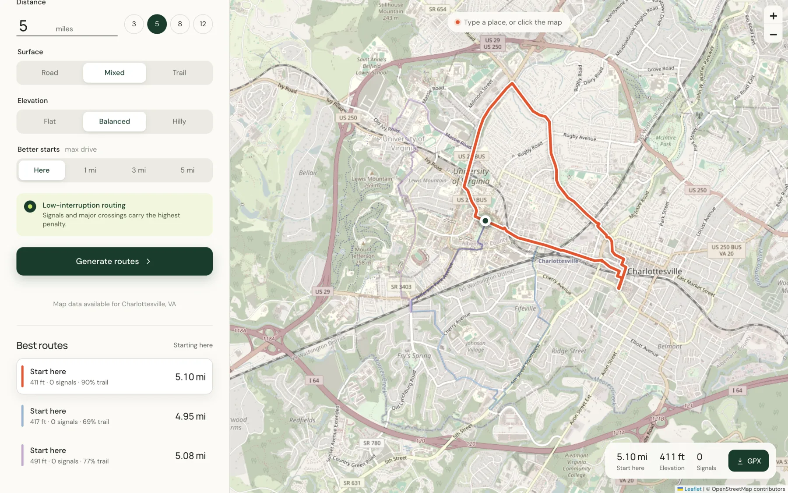
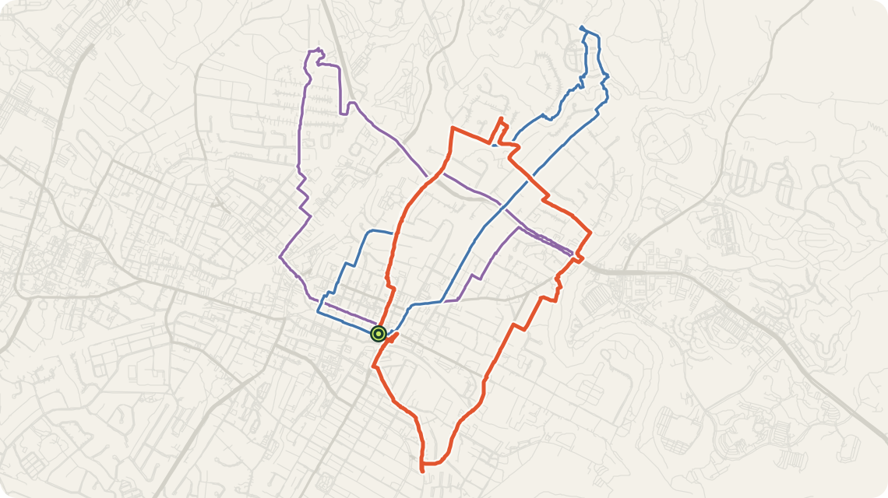
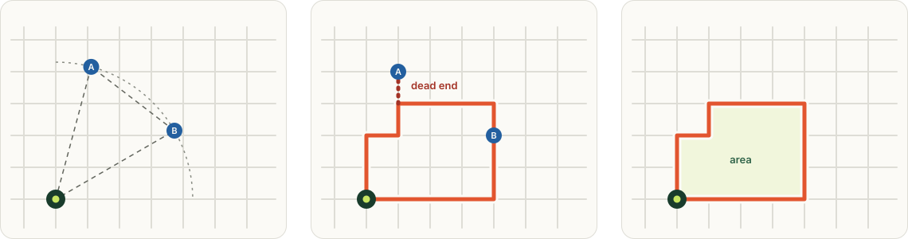
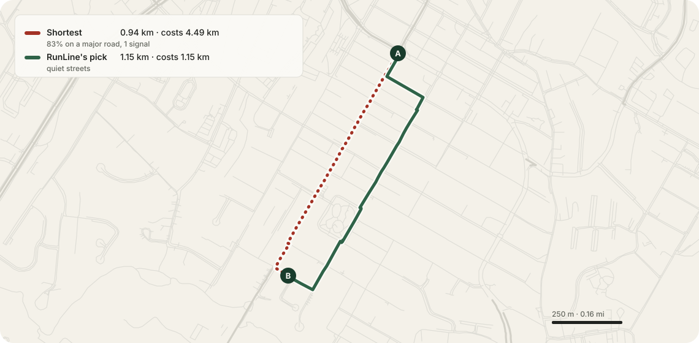
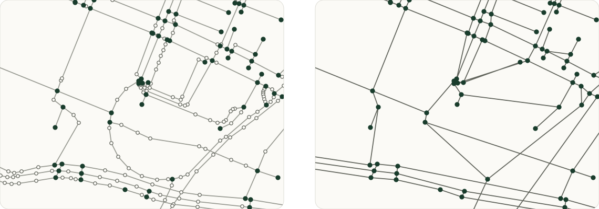
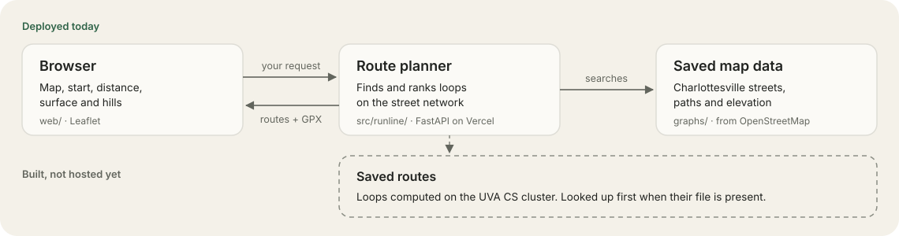
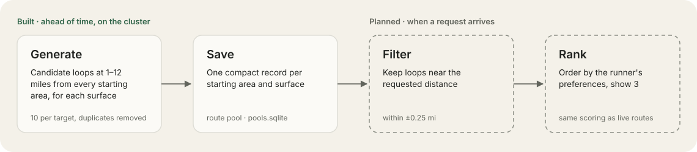
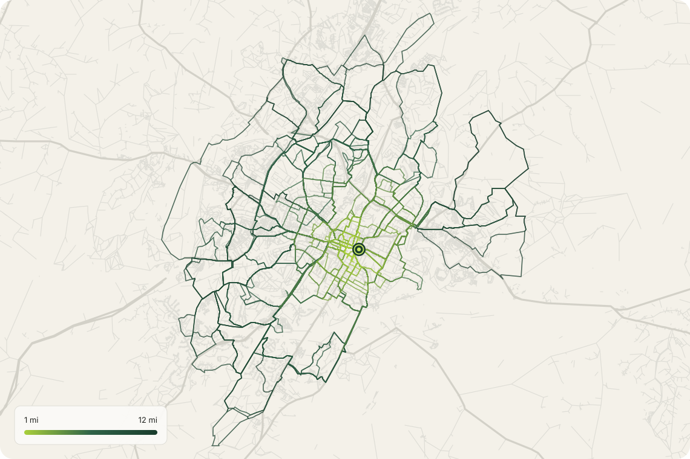

# RunLine

RunLine helps runners find routes that finish where they start. Choose a
starting location, a distance in miles, and your preferences for roads,
trails and hills. It suggests up to three routes, favoring fewer traffic
lights, major-road crossings and repeated sections. Download a route as a
GPX file, the route format compatible watches and navigation apps import.

**Current coverage:** Charlottesville, Virginia, answered from saved routes on
the deployed app, falling back to live planning when none fit. The top 50 US
metro areas are the goal.

**Capstone build:** [runline-capstone.vercel.app](https://runline-capstone.vercel.app)
— rebuilt Charlottesville graph and all 11,417 pools.

**Original deployment:** [runline-nine.vercel.app](https://runline-nine.vercel.app) · CS 4971
capstone (Adithya Balasubramaniam, Krish Patel, Rohan Singh)



## How to use it

1. **Pick a start.** Type a street or place, click the map, or use your
   location.
2. **Set a distance** in miles, a **surface** (road, mixed or trail) and
   **elevation** (flat, balanced or hilly).
3. Optionally, under **Better starts**, let RunLine compare starting from
   nearby trailheads, parks and public parking within a 1, 3 or 5 mile drive.
4. **Generate routes**, compare the cards, and download the one you like as
   **GPX**.

## A real example



<sub>Actual output for a 5 mile request from the Charlottesville map centre.
All three routes start and finish at the marker.</sub>

## Run it locally

You need **Git** and **Python 3.11 or newer**.

```bash
git clone https://github.com/RohanSi4/runline.git
cd runline
python3 -m venv .venv
.venv/bin/pip install -e '.[dev]'
```

On Windows, use `py -3.11 -m venv .venv` and `.venv\Scripts\pip install -e ".[dev]"`,
and `.venv\Scripts\` in place of `.venv/bin/` below.

**Start the website.** It keeps running in that terminal; stop it with
Ctrl+C, and open another terminal for anything else.

```bash
.venv/bin/runline-web
```

Then open <http://127.0.0.1:8765>.

**Or plan from the command line.** This writes `option-1.gpx` to
`option-3.gpx`, `routes.geojson`, `routes.json` (each route's numbers and
score) and `preview.html` (a map to compare them) into `output/rotunda-5/`.

```bash
.venv/bin/runline generate --address "Rotunda, Charlottesville" --distance 5 \
    --surface mixed --elevation balanced --output output/rotunda-5
```

**Run the tests.**

```bash
.venv/bin/python -m pytest -q
```

**Coverage when you run it yourself.** The deployed app only serves
Charlottesville and answers other starts with an error. A local copy can also
download OpenStreetMap data for a start elsewhere, which takes from seconds to
minutes, and caches it under `cache/`. Set `RUNLINE_ALLOW_OSM_DOWNLOAD=0` to
turn that off.

## How routing works

RunLine plans on a **walk graph**: a network of walkable streets and paths
from OpenStreetMap. Each **node** is an intersection or a dead end, and each
**edge** is the street or path segment between two of them.



1. **Choose waypoints.** Two points about a third of the target distance from
   the start, tried at 12 directions, 2 widths and 4–5 sizes.
2. **Connect streets.** The best path from the start to A, A to B, and B back
   to the start, then remove any dead end the route ran up and back down.
3. **Measure and rank.** Measure each loop's distance, traffic signals,
   major-road crossings, trail share, repeated sections, climb and roundness.
   For narrow routes that mostly retrace their outward journey, try a
   different return path. Then return up to three.

**Matching your distance.** Waypoints are tried widely, so the planner keeps
any loop between 55% and 150% of your target as raw material, not as an
answer. Ranking puts routes within **±0.25 mi** of the request first. If none
are, it returns the closest ones and says so.

### Avoiding busy roads

The planner looks for the *cheapest* path, not the shortest. **Cost** is a
preference score measured in equivalent meters, not extra distance you run:
every street costs its length, plus

| Penalty | Added cost |
|---|---|
| A traffic signal | +450 m |
| A major road | +1.8 × its length, at least +120 m |
| Arriving where a major road meets the route on two sides | +300 m |
| The wrong surface for your choice | +65% (want trail) or +80% (want road) of its length |



<sub>Two real paths between the same points. The shortest way is 0.94 km but
mostly on a major road, so it costs 4.49 km. The quiet parallel route is 1.15
km and costs only its length, so RunLine takes it.</sub>

**What it searches.** OpenStreetMap draws a street with every bend. The
planner only needs the intersections: the bends stay on each edge, so lengths
and the drawn route are unchanged, but there are far fewer points to search.



### Ranking

Among routes within ±0.25 mi of your distance, round loops come before
**slivers** (loops so narrow they are nearly an out-and-back), then the lowest
weighted score wins. The score adds these penalties:

| Distance off | Signals | Repeats | Shape | Crossings | Surface | Hills |
|:-:|:-:|:-:|:-:|:-:|:-:|:-:|
| 7.0 | 6.0 | 5.0 | 4.0 | 4.0 | 2.5 | 1.5 |

*Shape* is roundness, 4π × area ÷ length², the shaded area in step 3: a circle
scores 1 and the planner's triangles about 0.6. Below 0.2 a loop counts as a
sliver. Two options that share over 70% of their length count as one.

## Architecture



| Part | What it does | Where |
|---|---|---|
| Browser | Map, form, route comparison, GPX download (HTML/JS + Leaflet) | `web/` |
| Route planner | Finds, measures and ranks loops (Python, FastAPI on Oracle) | `src/runline/` |
| Saved map data | Charlottesville walk graph with elevation, built ahead of time | `graphs/`, `scripts/build_graphs.py` |
| Precompute | Generates saved routes on the UVA CS cluster | `scripts/precompute_pools.py`, `slurm/` |
| Serving | Answers from saved routes, or hands back to the planner | `src/runline/serving.py` |

## Precomputed routes

To cover more cities and answer faster, RunLine generates a collection of
candidate loops ahead of time for each starting area and surface. A request
filters these saved routes by distance and ranks them by the runner's
preferences. The collection does not include every possible route, so when a
start has no good answer saved, the planner searches live instead.



- A **cell** is a 200 m square starting area. Every start in a cell shares
  its saved routes.
- A **route pool** is one cell's saved collection for one surface: loops at
  whole-mile targets from 1 to 12, up to ten per target, with near-duplicates
  removed.
- A **tile** is a 13.8 km map region. Each metro area is split into tiles
  that overlap, so every cell's longest loop fits inside one tile's map.



<sub>One real route pool, from the Charlottesville map centre: all 113 saved
loops, the 10 within ±0.25 mi of 5 miles, and the 3 that ranking picks.</sub>

| Complete rebuilt Charlottesville pool check | Result |
|---|---:|
| Requests answered from pools | 548 / 600 (91.3%) |
| Local median pooled time | 64 ms |
| Local p95 pooled time | 129 ms |
| Mixed / road / trail hit rates | 92.0% / 90.5% / 91.5% |

<sub>40 seeded starts × five 3–12 mile distances × three surfaces. Twenty hits
returned two qualifying routes; other requests plan live. This check skipped
live timing. The historical paired study on the original graph measured 76 ms
pooled versus 1.41 s live; see [validation](docs/validation.md) for that study
and [presentation release](docs/presentation-release.md) for the new dataset
and public deployment checks.</sub>

**To try it locally,** put a pool file at `pools/charlottesville-va.sqlite`.
The API's `source` field then says `pool` or `live`.

**Metros** are served from their tiles. Each metro run is a directory under
`metros/` (or `RUNLINE_METROS_DIR`) holding the merged `pools.sqlite` and a
`tile-graphs/` directory of that run's tile graphs. A start finds its tile
from its cell, loads that tile's graph on first use, and keeps at most
`RUNLINE_TILE_GRAPHS_CACHE` (default 2) graphs in memory. A start with no
usable pool plans live on the same tile graph. `/api/areas` lists the served
metros after the shipped areas.

**Status:**

- **Charlottesville:** route pools are computed and served. Vercel proxies
  `/api` to Krish's Oracle VM, which holds the 110 MB pool file. The optional
  `deploy/` tooling is a portable VM recipe; the existing backend is retained.
- **Capstone deployment:** the rebuilt graph and complete 95 MB pool file are
  hosted directly on Vercel at the capstone URL. Its ten-scenario rehearsal
  returned 30 closed in-band routes with matching GPX exports.
- **Washington, DC:** the pilot finished, with 72,237 cells and 2.3 GB of pools.
  Serving metro tiles works in tests; serving DC needs its tile graphs and
  plan copied from the cluster (see `docs/handoff.md`, task 2).
- **Top 50 metro areas:** not run yet.

`docs/handoff.md` lists the remaining work, and `slurm/README.md` is the
cluster runbook.

## How it was built

| Stage | Change |
|---|---|
| 1 · Prototype | Command-line loop generator on live OpenStreetMap downloads, scored and exported to GPX |
| 2 · Ship it | Saved Charlottesville map data, drive-to starts and address suggestions, so the deployed app never waits on a download |
| 3 · Better loops | Major-road crossings counted from road directions; dead ends removed; narrow loops re-routed and ranked last |
| 4 · Faster | Faster path search, cached crossing checks and bounded searches: an 8 mile route went from 2.5 s to 0.7 s |
| 5 · Scale out | Metro tiling, a map builder for the US extract, a compact pool format and the cluster precompute |
| 6 · Serve | Requests answered from saved route pools, falling back to live planning |

Every routing change is checked against a 32-case benchmark
(`scripts/bench.py`) and a shape audit (`scripts/shape_audit.py`). The maps in
this README are rendered from real output by `scripts/readme_figures.py`.

## Limitations

Traffic signals and surfaces are only as complete as OpenStreetMap's tags,
and the 90 m elevation data describes terrain, not curbs. Check a route
before you run it. Map data © OpenStreetMap contributors (ODbL); elevation
© Copernicus DEM GLO-90.
