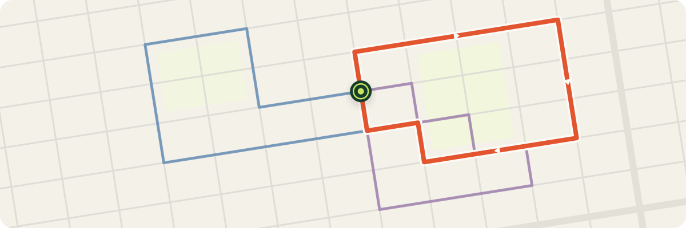
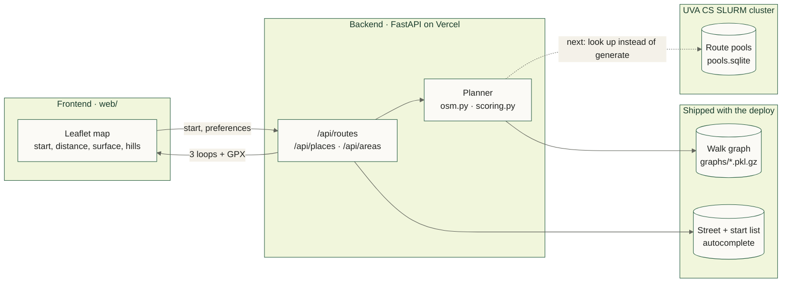
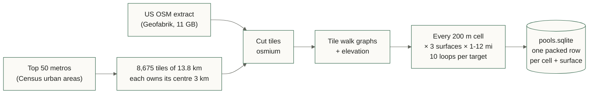

# RunLine

Pick a start and a distance; get running loops that come back to where you
started, with few traffic lights, few major-road crossings and the surface and
hills you asked for. Export to GPX for your watch.

**Live:** [runline-nine.vercel.app](https://runline-nine.vercel.app) · CS 4971
capstone (Adithya Balasubramaniam, Krish Patel, Rohan Singh)



## How it fits together



| Layer | What | Where |
|---|---|---|
| Frontend | Plain HTML/JS + Leaflet 1.9: map, form, route comparison, GPX download | `web/` |
| API | FastAPI: generate routes, autocomplete places, list covered areas | `src/runline/api.py` |
| Planner | Loop generation, scoring, ranking | `osm.py`, `scoring.py`, `planner.py` |
| Map data | OpenStreetMap walk graph with elevation baked in, built ahead of time | `graphs/`, `scripts/build_graphs.py` |
| Precompute | Every loop from every 200 m start cell, run on the cluster | `scripts/precompute_pools.py`, `slurm/` |

## How a loop is found


1. **Place waypoints.** Two points on a ring about a third of the target from
   the start, tried at 12 headings × 2 widths × 4–5 ring sizes.
2. **Connect them.** Shortest paths start → A → B → start on runner costs
   (scipy Dijkstra), then trim any dead-end spur the waypoints landed on.
3. **Measure and rank.** Keep loops within 55–150% of the target; measure
   distance, signals, crossings, trail share, repeats, climb and roundness;
   send sliver-shaped loops home on different streets; return the top 3.

**Edges cost what they cost a runner**: meters, plus penalties for a traffic
signal (+450 m), a major road (+1.8× its length), entering a node with major
road on two sides (+300 m), and the wrong surface for the request. Shortest
paths on those costs already avoid lights and busy roads.

**Scoring** adds weighted penalties; lowest wins:

| Distance off | Signals | Repeats | Shape | Crossings | Surface | Hills |
|:-:|:-:|:-:|:-:|:-:|:-:|:-:|
| 7.0 | 6.0 | 5.0 | 4.0 | 4.0 | 2.5 | 1.5 |

*Shape* is roundness, 4π·area / length², the shaded area above: a circle is
1, the planner's triangles about 0.6, and a loop under 0.2 is an out-and-back
in disguise, so it ranks after every round loop. Two options sharing over 70% of their length
count as one.

## Precomputing routes

Live generation takes 0.7–2.4 s per request. Distance and hill preference only
change the *ranking*, so every loop a start can have is computed ahead of time
and a request becomes a lookup.



- **Grid:** the world is cut into fixed 200 m cells (`200:<row>:<col>`), so a
  request's pool is found from its start point alone.
- **Tiles:** a 12 mile loop needs a 10.6 km disc of map. Tiles are big enough
  that every cell a tile owns has its whole disc inside it, and each cell is
  owned by exactly one tile.
- **Pools:** per cell and surface, every distinct loop at targets 1–12 miles,
  stored as delta-encoded node ids + metrics, lzma-compressed (~12 KB a cell).
- **Scale:** 3.35 M cells, 37,588 work units, up to 800 cores on the UVA CS
  cluster (`cpu` + `gpu` partitions). `slurm/README.md` is the runbook.

| | Live | Precomputed |
|---|---|---|
| Request time | 0.7–2.4 s | ~0.1 s (lookup + rank) |
| Coverage | Charlottesville | Top 50 US metros |
| Where it runs | Vercel, per request | Cluster, once per OSM update |

The app does not read pools yet; serving them is the next step.

## How it was built

| Stage | Change |
|---|---|
| 1 · Prototype | CLI loop generator on live Overpass downloads, scored and exported to GPX |
| 2 · Ship it | Prebuilt Charlottesville graph, drive-radius starts and autocomplete so Vercel never waits on Overpass |
| 3 · Better loops | Major-road crossings counted from road bearings; spurs trimmed; slivers re-routed and ranked last |
| 4 · Faster | scipy Dijkstra (1.6–1.9×), memoized crossings, bounded searches: 8 mi generation 2.5 s → 0.7 s |
| 5 · Scale out | Metro tiling, OSM-extract graph builder, packed pool format, SLURM precompute on the UVA CS cluster |

Every routing change is checked against a 32-case benchmark
(`scripts/bench.py`) and a shape audit (`scripts/shape_audit.py`).

## Run it

```bash
python3 -m venv .venv && .venv/bin/pip install -e '.[dev]'
.venv/bin/runline-web          # http://127.0.0.1:8765
.venv/bin/runline generate --address "Rotunda, Charlottesville" --distance 5 \
    --surface mixed --elevation balanced --output output/rotunda-5
.venv/bin/python -m pytest -q
```

Coverage is Charlottesville (`config/areas.json`); a start outside it returns
HTTP 422. Build or rebuild an area with `scripts/build_graphs.py`.

## Data and limits

Map data © OpenStreetMap contributors (ODbL). Elevation © Copernicus DEM
GLO-90. Signals and surfaces are only as complete as OSM tags, and 90 m
elevation describes terrain, not curbs: check a route before you run it.
Exact benchmark addresses stay in the gitignored `.private/`.
